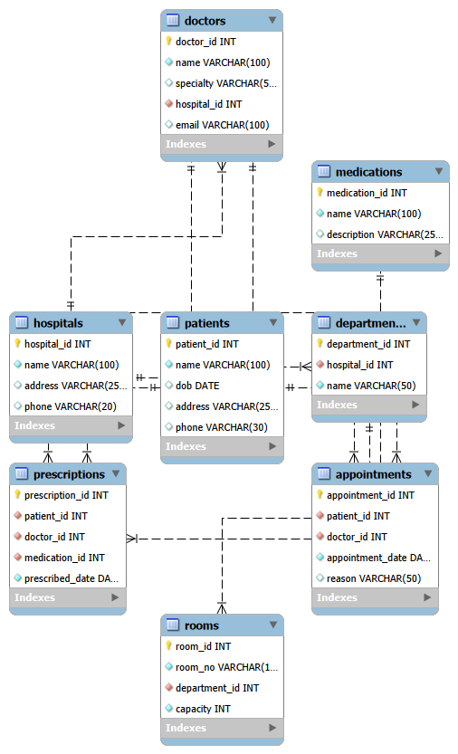

# 🏥 Hospital Management System — SQL Database & Analysis

A relational database for a multi-hospital network, built in MySQL: schema design with primary and foreign keys, data loading, integrity checks and 35 analysis queries using joins, subqueries, CTEs and window functions.

**Tools:** MySQL 8.0 · SQL (DDL, DML, CTEs, window functions)  
**Dataset:** Simulated data for a fictional hospital network: 10 hospitals · 30 doctors · 120 patients · 100 appointments · 45 departments · 62 medications · 77 prescriptions · 45 rooms (2025)

---

## 🗂️ Database Schema

| Table | Contents | Linked to |
|---|---|---|
| `hospitals` | Name, address and phone | — |
| `doctors` | Name, specialty and email | hospitals |
| `patients` | Demographics and contact details | — |
| `appointments` | Patient visits to a doctor | patients, doctors |
| `departments` | Departments within each hospital | hospitals |
| `medications` | Medicine catalogue | — |
| `prescriptions` | Medicine prescribed to a patient by a doctor | patients, doctors, medications |
| `rooms` | Rooms and capacity per department | departments |

- Primary key on every table and 8 foreign keys enforcing every relationship
- `NOT NULL`, `UNIQUE` (doctor email) and `CHECK` (room capacity > 0) constraints
- Integrity checks confirm zero orphan rows across all relationships

---

## 🔍 Questions Answered

**Core queries**
- Patients born after 2000
- All prescriptions for a given patient
- Appointments per month
- Medications for pain or infection (keyword search)
- Doctors with their hospital
- Patients with appointments in August 2025
- Room capacities in Neurology departments
- Doctors per hospital
- Patients with more than 3 appointments
- Appointments with patient and doctor names

**Advanced queries**
- Emergency patients by age group (`CASE`)
- Departments of a given hospital (subquery)
- Patients who have never had a prescription (`NOT EXISTS`)
- Patients seen at more than one hospital (`COUNT DISTINCT` + `HAVING`)
- Latest appointment per patient (`ROW_NUMBER`)
- 3rd most prescribed medication, including ties (`DENSE_RANK`)
- Hospitals with the lowest doctor count (CTE)
- Department with the second-largest room capacity in each hospital (`PARTITION BY`)

**Further insights**
- Top hospitals per specialty
- Room capacity per department and per hospital
- Monthly appointment trend with month-over-month change and running total (`LAG`)
- Appointments by weekday and by reason
- Hospital and doctor workload
- Patient age profile
- Data-quality checks

---

## 📊 Key Findings

- **Checkups are the most common reason for a visit (28%), but emergencies are close behind at 26%** of all 100 appointments.
- **February was the busiest month** with 15 appointments. Every other month from January to August stayed between 10 and 13.
- **Propranolol is the most prescribed medication** (5 prescriptions), followed by Paracetamol (4). Six medications tie for third with 3 each.
- **Doctor coverage is uneven:** Cedar Grove, Northwind and Lakeside have only 2 doctors each, while Green Valley, Harmony Hill and Oceanview have 4. Daniel Wright (Orthopedics) carries the heaviest load with 8 appointments.
- **Many registered patients are inactive:** 51 of 120 patients have no appointments, and 62 have never received a prescription.
- **Data-quality issues flagged:** 19 of 30 doctors work at a hospital with no department for their specialty (Orthopedics, Dermatology, Psychiatry, Gynecology and Emergency Medicine have no departments anywhere), 19 doctors have an email domain belonging to a different hospital, and Pinecrest and Oceanview have no rooms recorded.

---

## ▶️ How to Run

1. Install MySQL 8.0 or later (the CTEs and window functions need 8.0).
2. Open `hospital_management.sql` in MySQL Workbench and run the whole script. It creates the `hospital_management` schema, loads the data and runs every query.

---

## 📁 Files

| File | Description |
|---|---|
| `hospital_management.sql` | Full script: schema, data, integrity checks and all analysis queries |

---

## 👤 Author

**Salman Shahzad** — Data Analyst

